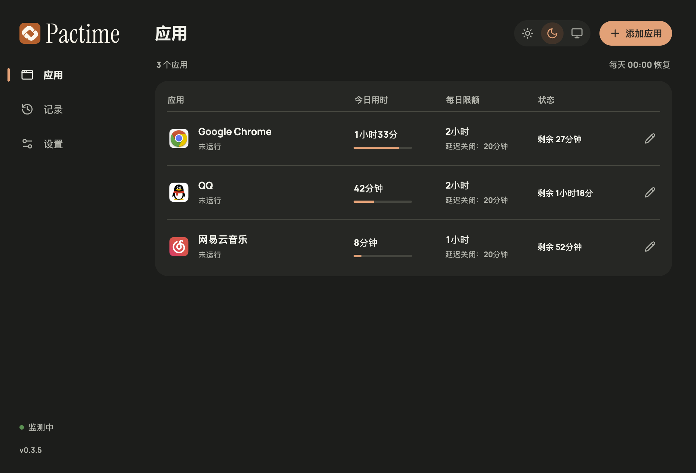

<p align="center">
  
</p>
<h1 align="center">Pactime</h1>
<p align="center"><strong>给每天的应用使用设个限额。</strong></p>
<p align="center">免费开源 · Windows 与 macOS · 本地运行</p>
<p align="center">
  <a href="https://github.com/Vergil-coder/pactime/releases"></a>
  <a href="https://github.com/Vergil-coder/pactime/stargazers"></a>
  <a href="LICENSE"></a>
  <a href="#下载"></a>
  <a href="#下载"></a>
</p>
<p align="center">
  <a href="README.md">English</a> · 简体中文<br>
  <a href="#下载">下载与安装</a> ·
  <a href="#开始使用">使用说明</a> ·
  <a href="#常见问题">常见问题</a> ·
  <a href="CONTRIBUTING.md">参与贡献</a>
</p>

Pactime 用来限制桌面应用每天的使用时间。比如给某个应用设定每天 2 小时，Pactime 会在后台计时，用完后自动关闭应用。如果需要时间保存文档或结束手头的事，可以提前设置 0–30 分钟的关闭延迟。

它适用于游戏、视频、社交等桌面应用，无需注册账号。

> 当前为早期预览版，支持简体中文和英文，可在设置中切换语言。Windows 和 Mac 的应用兼容性仍在测试中。首次试用请先保存工作，强制关闭可能丢失未保存的内容。

## 界面预览

| 浅色 | 深色 |
| --- | --- |
|  |  |

截图为 macOS 简体中文界面，列表中的用时和额度是示例数据。

## 功能

- 每个应用可以分别设置每日限额。同一规则里的多个进程共用一份计时。
- 用时和规则保存在本机，重启后继续计时，每天本地时间 00:00 恢复额度。
- 可以把已识别的关联程序纳入同一规则，也可以单独添加实际运行的程序。
- 弹窗与声音可以分别关闭。声音可选默认语音、轻提示音或标准提示音。
- 支持浅色、深色和跟随系统。界面语言可跟随系统，也可手动选择简体中文或英文。

## 下载

前往 [Releases 下载页面](https://github.com/Vergil-coder/pactime/releases)，展开对应版本的 **Assets** 查看安装包。如果还没有公开的安装包，可以先[从源码运行](#本地开发)。

| 平台 | 系统要求 | 文件 |
| --- | --- | --- |
| Windows | Windows 10/11，x64 | `.exe` 安装程序或完整应用 `.zip` |
| macOS | macOS 12+，Apple Silicon | `.dmg` 或应用 `.zip` |

目前未提供 Intel Mac、Linux、iOS 和 Android 版本。

Windows ZIP 需要完整解压后运行，数据仍保存在本机应用数据目录。GitHub 自动附加的 **Source code** 文件用于下载源码。当前 Windows 安装包尚未提供代码签名，Mac 包使用本地临时签名，未完成 Apple 公证。系统可能提示风险或拦截运行，请先核对下载来源和该版本说明，不要关闭系统安全保护。

## 开始使用

1. 打开 Pactime，点击「添加应用」。
2. 从运行列表选择应用，浏览程序文件，或直接拖入。Windows 支持 `.exe` 和 `.lnk`，Mac 支持 `.app`。
3. 设置每天可用时间和关闭延迟。首次可以选一个能随时关闭的应用，设为 1 分钟额度、0 分钟延迟，先试一遍。
4. 关闭主窗口后，Pactime 会留在托盘或菜单栏继续运行。

**添加规则前请留意：** 安装版只要还有规则，就会保持后台运行并启用登录启动，此时不能从普通「退出」入口结束 Pactime。增加额度、延长关闭延迟或移除规则，要等到明天生效；减少额度等更严格的修改会立即生效。取消关联程序限制同样从明天生效，开启关联程序限制则立即生效。

## 使用前需要了解

Pactime 按程序运行时间计时，切到后台也会计时，启动器挂着下载文件同样会消耗额度。它无法判断一场对局、一个视频或一项工作何时结束；关闭延迟需要在规则里提前设置，最多 30 分钟，到点后不能再次延长。延迟期间提前退出应用，会结束当天的这次延迟，重开后仍会受到限制。

电脑睡眠时不扣每日额度，但已经开始的关闭延迟不会推后。Pactime 没有运行时，无法补记这段时间的应用用时。

达到关闭时间后，Pactime 会持续检查应用是否重新启动，并再次尝试关闭，因此重开时窗口可能短暂出现。部分管理员程序和受保护进程可能无法关闭，启动器关联识别也可能遗漏应用。遇到遗漏时，可以直接添加实际运行的程序。

独占全屏可能挡住弹窗，可以提前试听语音或提示音。Pactime 适合主动控制自己的使用时间，设备管理员仍然可以结束或卸载它。

## 常见问题

### 应用不在列表里，或者无法关闭？

先刷新列表，搜索应用名称、窗口标题或程序路径，也可以浏览文件或直接拖入。Windows 提示访问被拒绝时，可以按界面提示以管理员身份重启 Pactime。受保护进程即使使用管理员权限，也可能无法关闭。

### 为什么受限应用还能短暂打开？

Pactime 在程序启动后检测并尝试关闭，通常约每 2 秒检查一次，因此重开时可能短暂看到窗口。

### 数据在哪，升级或卸载会清空吗？

从「设置 → 打开数据位置」查看。升级会继续使用原目录，保留规则和用时；卸载可能保留数据，Windows 安装程序会保留这些文件。升级前需退出旧版本，有规则时先安排移除，等到次日生效且所有规则移除后才能正常退出。

### 怎么反馈问题？

在仓库的 Issues 中填写 Pactime 版本、系统版本、重现步骤和实际结果。关闭失败时，请说明 Pactime 与目标程序的运行权限，并附上最新错误。提交前遮住截图和日志中的私人信息。安全问题请按[安全政策](SECURITY.md)报告。

## 隐私

规则、用时和最近 14 天的使用历史都保存在本机。Pactime 没有账号、广告、统计分析 SDK 或云同步，也不会自动上传崩溃记录或下载更新。

选择应用时会读取进程名称和程序路径，Windows 上还会读取窗口标题以便搜索。不采集键盘输入、屏幕内容、文档内容或浏览历史。详情见[隐私说明](PRIVACY.md)。

## 本地开发

需要 Node.js 22.12+ 和 npm。Mac 原生开发还需要 Xcode Command Line Tools。

```sh
npm ci
npm run dev
```

开发版使用独立数据目录，可以正常退出，但仍会关闭规则中选定的真实应用。只调整界面时，可以用 `npm run dev:web` 打开浏览器预览。

常用命令：

```sh
npm run dev:web    # Preview the UI in a browser
npm run typecheck  # Check TypeScript types
npm run build      # Build the application
npm run dist:win   # Build Windows x64 EXE and ZIP packages
npm run dist:mac   # Build macOS arm64 DMG and ZIP packages
```

安装依赖时会下载 Electron。下载失败时，可以运行 `npx install-electron` 后重试。界面修改会自动刷新，桌面主进程或原生代码修改后需要重启开发进程。浏览器预览地址为 `http://127.0.0.1:5178`，只使用模拟数据，不会读取或关闭本机应用。

安装包输出到 `release/`。Mac 打包需要 Apple Silicon Mac；在 Mac 上生成的 Windows 安装包仍需到 Windows 设备上检查。

## 参与贡献

可以在 Issues 反馈问题，也欢迎测试不同平台、修改文档或提交 PR。具体要求见[贡献指南](CONTRIBUTING.md)，安全漏洞请按[安全政策](SECURITY.md)报告。

近期会继续检查 Windows 和 Mac 的兼容性、权限处理和后台资源占用。移动端尚未实现。社区交流遵循[行为准则](CODE_OF_CONDUCT.md)。

## 作者

Pactime 由独立开发者 [快跑啊小卢\_](https://github.com/Vergil-coder) 开发和维护。

[GitHub](https://github.com/Vergil-coder) · [小红书](https://www.xiaohongshu.com/user/profile/5b07793a6b58b7646b6cea16) · [B 站](https://space.bilibili.com/237050518)

Pactime 的使用问题和建议，欢迎在仓库的 Issues 中交流，也方便其他人查阅。

## 开源许可

Pactime 使用 **GPL-3.0-only**，完整条款见 [LICENSE](LICENSE)，依赖和字体的许可见[第三方说明](THIRD_PARTY_NOTICES.md)。

当前免费使用。未来若提供付费功能或服务，会在发布时单独说明。
